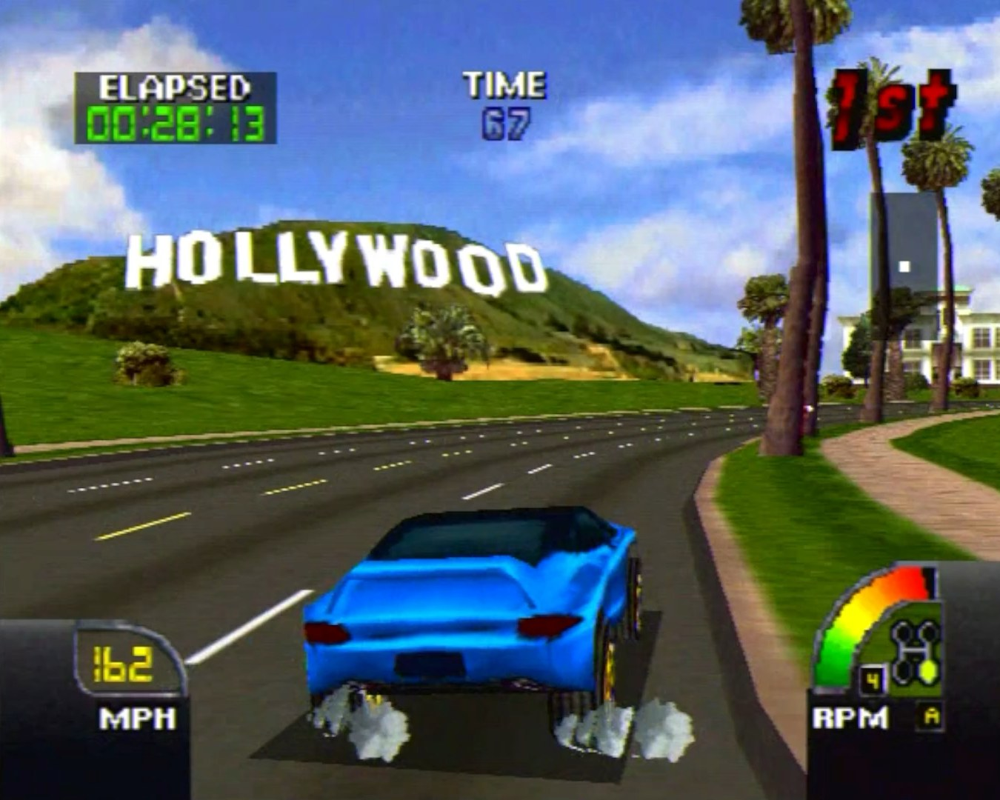
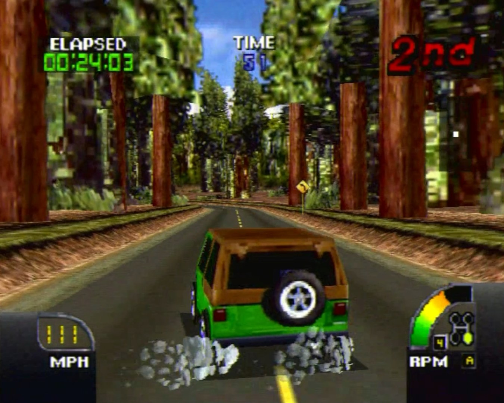
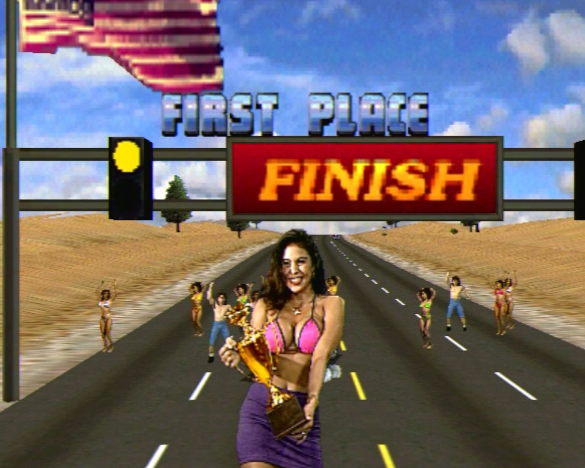
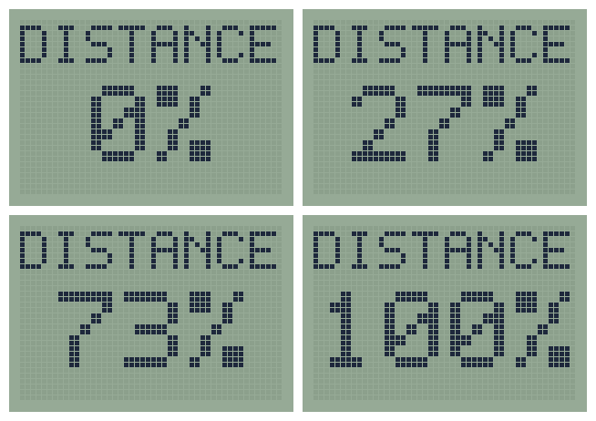

# Cruis'n USA for Sega Dreamcast

A native Sega Dreamcast port of the Nintendo 64 version of **Cruis'n USA**, built on
a decompilation of the N64 game which was part of this project.

**No game data is included.** You need your own legally owned copy of Cruis'n USA for
the Nintendo 64. The build reads the game's graphics, sound and data from your ROM and
puts them on the disc image that it makes. Please don't share any disc images that you might build.





## AI Disclosure

This port was written with the assistance of Claude. Hundreds of human testing hours were spent on real Dreamcast hardware testing, and then refining performance. If this use of AI is in conflict with your personal beliefs or values, please leave this page now. Thanks.

## Features

The N64 game's own code, decompiled to C, running natively on the Dreamcast. The same
tracks, cars, physics, CPU AI, menus, music and Hall of Fame, drawn by the Dreamcast's PowerVR
graphics chip at 30 frames a second, at 640x480.

Version 1.1 includes:

- A port of the N64 version, but now with a solid 30fps.
- Dreamcast-related easter eggs and secrets.
- Return of the arcade's bikini-clad trophy girl.
- Dreamcast button sprites and full controller mapping.
- VMU display functionality.
- Dreamcast exclusive cheat codes.
- Online leaderboards for all tracks.

## Requirements

- [KallistiOS](https://github.com/KallistiOS/KallistiOS) with its SH-4 toolchain
  (`kos-cc`), set up and working.
- [mkdcdisc](https://gitlab.com/simulant/mkdcdisc), to make the `.cdi` disc image.
- Python 3 (no extra packages needed).
- Your own Cruis'n USA ROM: **Cruis'n USA (USA) (Rev 1)**, in `.z64` (big-endian) byte
  order, SHA-1 `71bb3d8850b6a4a294aeca2abad1f936e4f85f0f`.

## Building

1. You must own Cruis'n USA for the Nintendo 64. Make a copy of your own cartridge's ROM
   and put it in the top folder of this project, named `baserom.z64`.
2. Load the KallistiOS environment:

   ```
   source /opt/toolchains/dc/kos/environ.sh
   ```

3. Build:

   ```
   cd dc/game
   ./build.sh
   ```

The build checks your ROM, converts the game's data from it (into `dc/game/cd/`),
compiles the game and makes **`dc/game/cruisn-game.cdi`**. Nothing is downloaded.

## Running

- **Real Dreamcast:** copy `cruisn-game.cdi` to your GDEMU (or burn it to a CD-R).

## Controls

The controls can be configured in OPTIONS -> CONTROLLER SETUP.

## Saving

Plug a VMU into the controller plugged into "Port A". The game saves your records, unlocked tracks,
faster cars and settings directly to the VMU (file `CRUISNUS.SYS`). This VMU file can be uploaded to Cruisn.net on a Dreamcast console to enter the online leaderboards. During a race, the VMU's screen shows how far you are through your race.



## Cheats

Plug a Dreamcast keyboard into "Port B", type a code on the **Choose Race** screen and press Enter.
Upper or lower case both work and you can type the same code again to turn it off. Cheats never change your
save.

| Code | Screen Confirmation | Cheat |
|---|---|---|
| XMAS | SNOW RACING! | It's now snowing on every track, with Christmas music on the radio! |
| APRILSHOWERS | RAIN RACING! | It's now raining on every track. |
| TAKEMEBACK | ORIGINAL N64 SPRITES | Reverts all sprites back to the N64 originals (trophy girl, etc). |
| HOTRODS | FASTER CARS UNLOCKED | Unlocks all of the faster car variants. |
| MURICA | ALL TRACKS UNLOCKED | Unlocks all tracks. |
| BARNFIND | SECRET CARS UNLOCKED | Unlocks the secret cars (Jeep, School Bus, Police Car). |
| ENTHUSIAST | REAL CAR NAMES | Gives the cars their correct name. |

Note: If your Dreamcast's calendar date is set to 24th/25th December, it will be snowing by default. If your Dreamcast's calendar date is set to 1st April, it will be raining by default.

## Layout

| Folder | Contents |
|---|---|
| `src/` | The decompiled N64 game. |
| `include/` | Its headers. |
| `port/` | The Dreamcast port: N64 graphics to PowerVR (`gfx.c`, `gfx_replay.h`), sound, saves, cheats, the port's own art and music. |
| `dc/game/` | The Dreamcast build (`build.sh`, `plat_dc.c`: KallistiOS video, sound, controllers, VMU). |
| `tools/` | The Python tools the build uses to convert the game's data from your ROM. |
| `images/` | The screenshots on this page, captured from real Dreamcast hardware. |

## Credits

- Thanks to Brendan "[Cypress](https://github.com/cypressru)" Lawson for Dreamcast development assistance and advice on tap!
- [KallistiOS](https://github.com/KallistiOS/KallistiOS) and the Dreamcast homebrew
  community, [mkdcdisc](https://gitlab.com/simulant/mkdcdisc), [Flycast](https://github.com/flyinghead/flycast).
- Secret rain effect: modelled from Top Gear Rally's rain effect ([Top Gear Rally decompilation](https://github.com/jeff-strutb/brally)).
- The arcade trophy girl animation is directly from the Cruis'n USA arcade game.
- Cruis'n USA is (c) Midway / Nintendo. This project is not affiliated with or endorsed
  by them.
- This is a non-commercial preservation project and is not affiliated with or endorsed by Nintendo or Sega.
